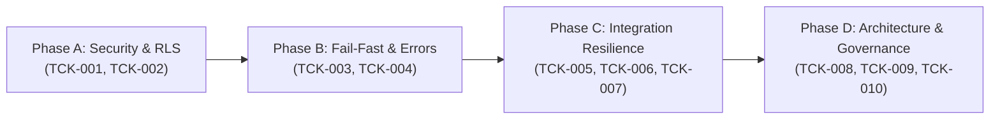

# System Technical Audit Report

- **Target System**: Production Retail Analytics & ERP Synchronization Platform
- **Lead Auditor**: Chief Engineering Auditor & Swarm Scout
- **Audit Date**: 2026-11-23
- **Primary Canon Reference**: [wiki/index.md](./wiki/index.md) (15 Proof Canons)
- **Status**: **CONDITIONAL PASS — Phase 2 Plan Formulated (Remediation Pending)**

---

## 1. Executive Verdict & Domain Scoreboard

The baseline audit conducted a thorough evaluation of the target application across six architectural and operational dimensions. The system exhibits strong foundation and domain separation, with mature transactional boundaries. However, targeted remediation is required to close critical security exposure in Row Level Security (RLS) tables, timing-safe authentication, and silent failure swallows in webhook ingestion hot paths.

### Domain Scoreboard

| Evaluation Domain | Weight | Score (/100) | Risk Profile | Status | Grounding Canons |
|---|---|---|---|---|---|
| **Architecture & Structural Integrity** | 20% | 82 | Low-Moderate Risk | Pass | [Ref 01](./wiki/01-ousterhout-module-depth.md), [Ref 09](./wiki/09-clean-architecture-boundaries.md) |
| **Security & Vulnerability Posture** | 25% | 74 | Elevated Risk | **Action Required** | [Ref 14](./wiki/14-owasp-security-and-supabase-rls.md) (OWASP Top 10) |
| **Reliability & Error Resilience** | 20% | 76 | Moderate Risk | Needs Attention | [Ref 11](./wiki/11-nygard-production-stability.md) (*Release It!*) |
| **Database & Schema Evolution** | 15% | 88 | Low Risk | Pass | [Ref 02](./wiki/02-kleppmann-schema-evolution.md), [Ref 13](./wiki/13-postgres-query-performance.md) |
| **Maintainability & Type Safety** | 10% | 85 | Low Risk | Pass | [Ref 07](./wiki/07-typescript-conventions.md), [Ref 06](./wiki/06-fowler-refactoring-vocabulary.md) |
| **Compliance & Data Governance** | 10% | 80 | Low Risk | Pass | [Ref 00](./wiki/00-canon-index-and-conflicts.md), [Ref 03](./wiki/03-kimball-star-schema-retail.md) |
| **Composite Weighted Score** | **100%** | **80.3 / 100** | **Moderate Risk** | **CONDITIONAL PASS** | |

---

## 2. Findings Summary Matrix

| ID | Title | Severity | Category | Location | Canon | Ticket |
|---|---|---|---|---|---|---|
| **[AUD-001](./findings/AUD-001.md)** | Missing RLS policies on `webhook_events` & `sync_runs` | **High** | Security | `supabase/migrations/` | [Ref 14](./wiki/14-owasp-security-and-supabase-rls.md) | [TCK-001](./tickets/TCK-001.md) |
| **[AUD-002](./findings/AUD-002.md)** | Bosta webhook auth uses plain string comparison | **Medium** | Security | `src/app/api/webhooks/bosta/` | [Ref 14](./wiki/14-owasp-security-and-supabase-rls.md) | [TCK-002](./tickets/TCK-002.md) |
| **[AUD-003](./findings/AUD-003.md)** | `markWebhookEvents` swallows DB failures silently | **Medium** | Reliability | `src/server/integrations-repo.ts` | [Ref 11](./wiki/11-nygard-production-stability.md) | [TCK-003](./tickets/TCK-003.md) |
| **[AUD-006](./findings/AUD-006.md)** | Enqueue RPC failure returns HTTP 200 silently | **Medium** | Reliability | `src/app/api/webhooks/route.ts` | [Ref 11](./wiki/11-nygard-production-stability.md) | [TCK-004](./tickets/TCK-004.md) |
| **[AUD-007](./findings/AUD-007.md)** | Domain sync services mixed in `src/lib/` | **Medium** | Architecture | `src/lib/` | [Ref 09](./wiki/09-clean-architecture-boundaries.md) | [TCK-008](./tickets/TCK-008.md) |
| **[AUD-004](./findings/AUD-004.md)** | 10-minute wall-clock bucket in Bosta dedup key | **Low** | Reliability | `src/server/bosta/` | [Ref 02](./wiki/02-kleppmann-schema-evolution.md) | [TCK-007](./tickets/TCK-007.md) |
| **[AUD-005](./findings/AUD-005.md)** | `listWebhookSubscriptions` capped at 100 without pagination | **Low** | Reliability | `src/server/shopify/` | [Ref 11](./wiki/11-nygard-production-stability.md) | [TCK-005](./tickets/TCK-005.md) |
| **[AUD-008](./findings/AUD-008.md)** | Missing retry/circuit-breaker on Shopify GraphQL calls | **Low** | Reliability | `src/server/shopify/` | [Ref 11](./wiki/11-nygard-production-stability.md) | [TCK-006](./tickets/TCK-006.md) |
| **[AUD-009](./findings/AUD-009.md)** | Migration `20260917180000` lacks verifiable down comment | **Low** | Governance | `supabase/migrations/` | [Ref 02](./wiki/02-kleppmann-schema-evolution.md) | [TCK-009](./tickets/TCK-009.md) |
| **[AUD-010](./findings/AUD-010.md)** | BOM preservation edge-case in `readTextCapped` | **Low** | Reliability | `src/lib/utils/` | [Ref 14](./wiki/14-owasp-security-and-supabase-rls.md) | [TCK-010](./tickets/TCK-010.md) |

---

## 3. Detailed Finding Breakdowns

### AUD-001: Missing RLS Policies on Tenant Tables (High)
- **Defect**: PostgreSQL tables `webhook_events` and `sync_runs` have `ROW LEVEL SECURITY` enabled, but 0 active policies defined. Currently protected only by implicit `service_role` bypass in backend clients.
- **Risk Scenario**: If a client connection ever uses an authenticated anon or user JWT context, all queries fail or leak multi-tenant records.
- **Remediation**: Add explicit tenant-isolation RLS policies using `tenant_id = auth.jwt() ->> 'tenant_id'` or restrict strictly to service role. Add additive migration with `REVERSE` comment.
- **Ticket**: [TCK-001](./tickets/TCK-001.md)

### AUD-002: Bosta Webhook Timing Side-Channel (Medium)
- **Defect**: Bosta signature verification checks shared secrets using JavaScript standard string comparison (`===`), vulnerable to timing analysis attacks. Shopify webhooks correctly use `crypto.timingSafeEqual`.
- **Risk Scenario**: An attacker measures microsecond response variances across varying secret prefixes to reconstruct the webhook secret.
- **Remediation**: Migrate Bosta signature verification to `crypto.timingSafeEqual(Buffer.from(a), Buffer.from(b))`.
- **Ticket**: [TCK-002](./tickets/TCK-002.md)

### AUD-003: Silent Failure Swallowing in Event Persistence (Medium)
- **Defect**: `markWebhookEvents` catches database update rejections, logs via `console.error`, and returns without bubbling error state.
- **Risk Scenario**: During database connection pooling exhaustion or transient network blips, failed event state transitions are masked, relying entirely on the background stuck-event sweeper.
- **Remediation**: Return structured `Result<{ success: boolean; error?: Error }>` and fail-fast at the API route level.
- **Ticket**: [TCK-003](./tickets/TCK-003.md)

### AUD-006: Silent HTTP 200 on Enqueue RPC Failure (Medium)
- **Defect**: When `JOB_QUEUE=on`, failure to enqueue a job via `rpc_enqueue_job` is absorbed and answered with HTTP 200.
- **Risk Scenario**: Provider believes delivery succeeded and ceases retry backoff, creating an unacknowledged data gap window.
- **Remediation**: Return HTTP 503 on enqueue failure so upstream webhook delivery queues retry automatically.
- **Ticket**: [TCK-004](./tickets/TCK-004.md)

### AUD-007: Domain Services Mixed in Utility Layer (Medium)
- **Defect**: Stateful domain services (`sync-service.ts`, `orchestrator.ts`) reside inside `src/lib/` mixed with stateless pure utilities (`date.ts`, `format.ts`). Violates Clean Architecture dependency direction.
- **Remediation**: Execute an atomic Move Function refactoring moving domain services to `src/server/services/`, leaving re-exports with `@deprecated` tags during transition. (Preserve frozen ERP and ingestion paths).
- **Ticket**: [TCK-008](./tickets/TCK-008.md)

---

## 4. Phased Remediation Plan & Roadmap

Remediation is broken into four sequential phases, strictly bounded to prevent scope creep:

1. **Phase A (Critical Security)**: TCK-001 (RLS policies) + TCK-002 (Timing-safe auth). Zero dependencies, completely parallel.
2. **Phase B (Reliability & Fail-Fast)**: TCK-003 (Structured errors) + TCK-004 (503 on enqueue failure).
3. **Phase C (Integration Resilience)**: TCK-005 (Cursor pagination) + TCK-006 (Shopify backoff retries) + TCK-007 (Bosta dedup test & documentation).
4. **Phase D (Architecture & Governance)**: TCK-008 (Move services to `src/server/services/`) + TCK-009 (Migration lint & reverse check) + TCK-010 (BOM tests).

---

## 5. Verification Policy & Invariants

- **Frozen Boundaries**: `src/lib/erp/**`, `fixtures/**`, and `scripts/verify-erp-*` remain completely frozen.
- **Deterministic Verification**: Every ticket must pass `scripts/preflight.sh` (`tsc`, `eslint`, `knip`, `squawk`, `vitest`).
- **Single AI Review**: Exactly one independent review pass per phase via `verifier` (Claude Sonnet 4.6). No recursive critique loops.
- **Release Gate**: No deployment without Jou's explicit `deploy` confirmation in the active session.
