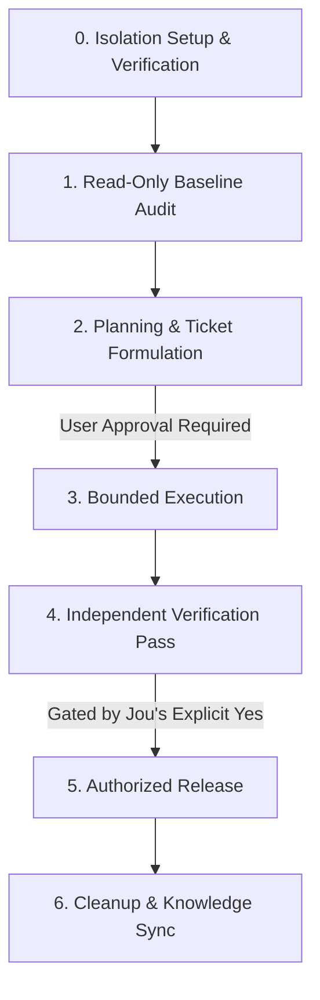

# Isolated Engineering Audit Skill

This skill operationalizes the **Isolated Engineering Audit Contract**. It governs independent inspection, baseline auditing, repair planning, bounded remediation, verification, and release orchestration for production applications.

## Core Principle: Isolation First

Before executing any audit step or reading application code:
1. **Never inherit** historical development workflows, agent orchestration, recursive critique/review loops, or ad-hoc preferences.
2. Establish a dedicated audit environment outside the existing workspace hierarchy.
3. Ensure git branch isolation (e.g. `audit/<date>-baseline`).
4. Inspect and neutralize any auto-loaded hooks, plugins, or MCP servers that introduce unwanted automation.
5. Work via durable state files, not conversational memory.

---

## Workflow Phases

### Phase 0: Isolation Verification
Run [verify-isolation.sh](./scripts/verify-isolation.sh) to confirm:
- Workspace is decoupled from existing development hierarchies.
- Branch is an isolated audit branch.
- No unwanted hooks or circular automation gates are active.
- Document any non-isolatable inherited configuration before proceeding.

### Phase 1: Baseline Audit (Strictly Read-Only)
- **Rules**: Do not modify application code. Do not assume missing patterns are defects.
- **Vectors to inspect**:
  - Code quality & maintainability
  - System architecture & data flow
  - Frontend & backend performance
  - Database schema, relationships, indexing & query efficiency
  - Authentication, authorization & session boundaries
  - Financial/data integrity and calculation accuracy
  - External APIs and integration reliability
  - Dependency & supply-chain vulnerabilities
  - Docker, runtime, and deployment configurations
  - Automated test coverage & regression suites
- **Findings format**: Every issue must use [finding-template.md](./templates/finding-template.md).

### Phase 2: Planning & Repair Tickets
- Group confirmed findings into small, coherent phases based on:
  1. Production risk & security impact
  2. Data integrity
  3. Functional dependencies
  4. Performance benefit vs implementation cost
- **Rule**: Prefer repairing existing code over architectural rewrites or new dependencies.
- **Deliverable**: Complete plan with tickets structured via [ticket-template.md](./templates/ticket-template.md).
- **Gate**: Stop and present plan to the operator for explicit approval.

### Phase 3: Bounded Execution
- Work in small, isolated batches against approved tickets.
- Enforce test coverage for confirmed defects before fixing.
- Preserve all financial calculations, business behaviors, and API contracts unless explicit approval was granted to alter them.
- Maintain active phase status using [phase-state-template.md](./templates/phase-state-template.md).

### Phase 4: Independent Verification
- Run deterministic checks (linters, typecheck, tests) first.
- Exactly **one** fresh, independent AI review pass per completed implementation phase (e.g., Opus reviewer or Codex).
- **Prohibited**: Circular critique, recursive review retries, or redundant review agents.
- Distinguish confirmed defects from style preferences. Fix blocking defects and re-verify only the affected diff.

### Phase 5: Authorized Release (HITL Gated)
- Requires explicit operator authorization (`deploy`) in the active session.
- Pre-flight checklist:
  - Branch, commit, and target environment verified.
  - Rollback procedure and database backup confirmed.
  - Migrations validated for backward compatibility.
  - Full automated test suite passing.
- Post-deployment: Execute smoke tests and runtime log validation immediately. Roll back on blocking anomalies.

### Phase 6: Post-Release Cleanup
- Sync architecture documentation and system wiki to reflect actual deployed code.
- Archive audit findings, evidence, and release logs.
- Identify and safely remove temporary audit branches and artifacts after verification.

---

## Agent Roster & Division of Labor

Refer to [agent-roster.md](./references/agent-roster.md) for agent assignments:
- **Codebase Reconnaissance**: Claude Haiku / Sonnet
- **Architecture & Repair Plan**: Claude Opus
- **Bounded Code Fixes**: Agy / Gemini
- **Docker Audit**: Claude with Docker Skills
- **Static Security Analysis**: Trail of Bits skills & security scanners
- **Independent Verification**: Codex
- **Final Review & Operator Approval**: Claude Opus + Operator (Jou)

---

## References & Templates
- [Audit Contract Full Text](./references/contract.md)
- [Agent Roster & Handoffs](./references/agent-roster.md)
- [Audit Checklist & Inspection Vectors](./references/audit-checklist.md)
- [Finding Template](./templates/finding-template.md)
- [Ticket Template](./templates/ticket-template.md)
- [Phase State Template](./templates/phase-state-template.md)
