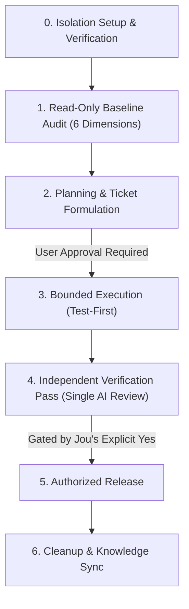

# Isolated Engineering Audit Skill

This skill operationalizes the **Isolated Engineering Audit Contract** grounded in the **Engineering Audit Knowledge Graph** ([wiki/index.md](./wiki/index.md)). It governs independent inspection, baseline auditing, repair planning, bounded remediation, verification, and release orchestration for production applications.

## Core Principle: Isolation & Grounding First

Before executing any audit step or reading application code:
1. **Grounding**: All evaluations, findings, and refactoring proposals must align with the 15 proof canons codified in [wiki/index.md](./wiki/index.md).
2. **Precedence**: Overlapping or conflicting guidelines must follow the Master Conflict Precedence in [wiki/00-canon-index-and-conflicts.md](./wiki/00-canon-index-and-conflicts.md).
3. **Isolation**: Never inherit historical development workflows, agent orchestration, recursive critique/review loops, or ad-hoc preferences.
4. **Environment**: Establish a dedicated audit environment outside the existing workspace hierarchy on an isolated branch.
5. **Durable State**: Work via durable state files, not conversational memory.

---

## Workflow Phases

### Phase 0: Isolation Verification
Run [verify-isolation.sh](./scripts/verify-isolation.sh) to confirm:
- Workspace is decoupled from existing development hierarchies.
- Branch is an isolated audit branch.
- No unwanted hooks or circular automation gates are active.
- Document any non-isolatable inherited configuration before proceeding.

### Phase 1: Baseline Audit (Strictly Read-Only across 6 Dimensions)
- **Rules**: Do not modify application code. Do not assume missing patterns are defects.
- **Vectors to inspect**:
  1. *Architecture & Structural Integrity* (Clean Architecture, DDD, Module Depth: [Ref 01](./wiki/01-ousterhout-module-depth.md), [Ref 04](./wiki/04-ddd-bounded-contexts.md), [Ref 09](./wiki/09-clean-architecture-boundaries.md))
  2. *Security & Vulnerability Posture* (OWASP, RLS, Secret Exposure: [Ref 14](./wiki/14-owasp-security-and-supabase-rls.md))
  3. *Reliability & Error Resilience* (Stability, Circuit Breakers: [Ref 11](./wiki/11-nygard-production-stability.md))
  4. *Performance & Scalability* (Postgres Indexes, Query Optimization: [Ref 13](./wiki/13-postgres-query-performance.md))
  5. *Maintainability & Code Health* (Type Safety, Dead Code: [Ref 07](./wiki/07-typescript-conventions.md), [Ref 06](./wiki/06-fowler-refactoring-vocabulary.md))
  6. *Compliance & Data Governance* (Schema Evolution, Financial Immutability: [Ref 02](./wiki/02-kleppmann-schema-evolution.md), [Ref 03](./wiki/03-kimball-star-schema-retail.md))
- **Inspection Tools**:
  - Preflight Runner: [scripts/preflight.sh](./scripts/preflight.sh)
  - Live Catalog Audit: [scripts/audit-supabase-catalog.sql](./scripts/audit-supabase-catalog.sql)
  - Boundary Enforcement: [configs/eslint.config.mjs](./configs/eslint.config.mjs)
  - Dead Code Detection: [configs/knip.json](./configs/knip.json)
  - Migration Safety: [configs/squawk.toml](./configs/squawk.toml)
- **Findings format**: Every issue must use [templates/finding-template.md](./templates/finding-template.md) and report via [templates/audit-report-template.md](./templates/audit-report-template.md).

### Phase 2: Planning & Repair Tickets
- Group confirmed findings into small, coherent phases based on:
  1. Production risk & security impact
  2. Data integrity & financial correctness
  3. Functional dependencies
  4. Performance benefit vs implementation cost
- **Rule**: Prefer repairing existing code over architectural rewrites or new dependencies (Ousterhout / Fowler).
- **Deliverable**: Complete plan with tickets structured via [templates/ticket-template.md](./templates/ticket-template.md).
- **Gate**: Stop and present plan to Operator Jou for explicit approval.

### Phase 3: Bounded Execution
- Work in small, isolated batches against approved tickets.
- Enforce test coverage for confirmed defects before fixing ([Ref 05](./wiki/05-khorikov-testing-policy.md)).
- Preserve all financial calculations, business behaviors, and API contracts unless explicit approval was granted to alter them.
- Maintain active phase status using [templates/phase-state-template.md](./templates/phase-state-template.md).

### Phase 4: Independent Verification
- Run deterministic checks (`./scripts/preflight.sh`) first.
- Exactly **one** fresh, independent AI review pass per completed implementation phase (e.g., Opus reviewer or Codex).
- **Prohibited**: Circular critique, recursive review retries, or redundant review agents.
- Distinguish confirmed defects from style preferences. Fix blocking defects and re-verify only the affected diff.

### Phase 5: Authorized Release (HITL Gated)
- Requires explicit operator authorization (`deploy`) in the active session.
- Pre-flight checklist:
  - Branch, commit, and target environment verified.
  - Rollback procedure and database backup confirmed.
  - Migrations validated for backward compatibility ([Ref 02](./wiki/02-kleppmann-schema-evolution.md)).
  - Full automated test suite passing.
- Post-deployment: Execute smoke tests and runtime log validation immediately. Roll back on blocking anomalies.

### Phase 6: Post-Release Cleanup
- Sync architecture documentation and system wiki to reflect actual deployed code.
- Record architectural decisions using [templates/madr-4.0-template.md](./templates/madr-4.0-template.md).
- Archive audit findings, evidence, and release logs.
- Identify and safely remove temporary audit branches and artifacts after verification.

---

## Agent Roster & Swarm Roles

Refer to [references/agent-roster.md](./references/agent-roster.md) for agent assignments:
- **Codebase Reconnaissance**: Claude Sonnet (`claude-sonnet-4-6`)
- **Architecture & Repair Plan**: Claude Opus (`claude-opus-4-6-thinking`)
- **Bounded Code Fixes**: Agy / Gemini (`gemini-3.8-flash-high`)
- **Docker & Security Audit**: Claude Sonnet (`claude-sonnet-4-6`)
- **Independent Verification**: Codex / GPT-OSS (`gpt-oss-120b-medium`)
- **Final Review & Operator Approval**: Claude Opus + Operator (Jou)

---

## References & Knowledge Graph
- [Master Knowledge Graph Index](./wiki/index.md)
- [Audit Contract Full Text](./references/contract.md)
- [Agent Roster & Handoffs](./references/agent-roster.md)
- [Audit Checklist & Inspection Vectors](./references/audit-checklist.md)
- [Finding Template](./templates/finding-template.md)
- [Ticket Template](./templates/ticket-template.md)
- [Phase State Template](./templates/phase-state-template.md)
- [ADR Template (MADR 4.0)](./templates/madr-4.0-template.md)
- [Audit Report Template](./templates/audit-report-template.md)
