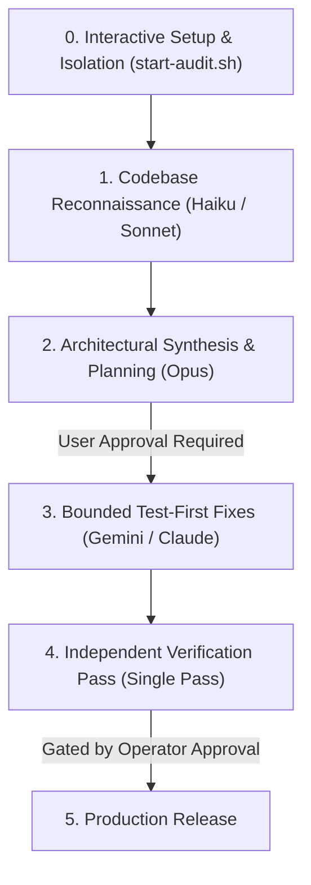

# Isolated Engineering Audit Skill (AuditSkill)

This skill operationalizes the **Isolated Engineering Audit Contract** grounded in the **Engineering Audit Knowledge Graph** ([wiki/index.md](./wiki/index.md)). It guides AI coding agents (Claude Code, Antigravity) to independently inspect codebases, spot architectural risks, structure bounded repair tickets, and verify diffs deterministically.

## Quickstart: Auditing Any Project

Run the interactive setup script:
```bash
./scripts/start-audit.sh
```
Or specify the target directly:
```bash
./scripts/start-audit.sh /path/to/target-repo
```

The script:
1. Verifies Git isolation (switches to dedicated `audit/<date>-baseline` branch).
2. Initializes an **Obsidian-ready** `audit/` folder inside the target project.
3. Symlinks the 15-canon Knowledge Graph into the target for native Obsidian graph traversal.
4. Prepares the preflight and boundary verification suite.

---

## 4-Phase Operational Execution



### Phase 1: Codebase Reconnaissance (Haiku / Sonnet)
- **Role**: Scout the target codebase across the 6 audit dimensions (Architecture, Security, Reliability, Performance, Maintainability, Governance).
- **Tooling**:
  - `npx tsc --noEmit` & `npx eslint .`
  - Knip dead-code detection ([configs/knip.json](./configs/knip.json))
  - Squawk SQL migration linting ([configs/squawk.toml](./configs/squawk.toml))
  - Live catalog queries ([scripts/audit-supabase-catalog.sql](./scripts/audit-supabase-catalog.sql))
- **Output**: File findings in `audit/findings/AUD-XXX.md` using [templates/finding-template.md](./templates/finding-template.md) with Obsidian frontmatter and `[[wikilinks]]`.

### Phase 2: Architectural Synthesis & Planning (Opus)
- **Role**: Synthesize findings into bounded phase repair tickets ([templates/ticket-template.md](./templates/ticket-template.md)) and master plan ([templates/phase-state-template.md](./templates/phase-state-template.md)).
- **Rule**: Prefer repairing existing code over architectural rewrites or new abstractions per Ousterhout ([Ref 01](./wiki/01-ousterhout-module-depth.md)) and Fowler ([Ref 06](./wiki/06-fowler-refactoring-vocabulary.md)).
- **Gate**: Stop and present plan to Operator Jou for explicit sign-off on open decisions.

### Phase 3: Bounded Implementation
- Implement approved tickets test-first per Khorikov ([Ref 05](./wiki/05-khorikov-testing-policy.md)).
- Maintain strict multi-tenant isolation and immutable ledger constraints ([Ref 14](./wiki/14-owasp-security-and-supabase-rls.md)).
- Never modify frozen ERP or ingestion core modules.

### Phase 4: Independent Verification
- Run `./scripts/preflight.sh` to deterministically verify code quality and tests.
- Exactly **one** independent AI review pass per phase diff. No circular review loops.

---

## Obsidian Integration

All findings, tickets, phase plans, and reports generated by this skill include Obsidian YAML frontmatter:
```yaml
---
type: finding
id: AUD-001
severity: High
category: Security
status: open
canon: "[[14-owasp-security-and-supabase-rls]]"
tags: [audit, finding, security]
---
```
When opened in Obsidian:
- Graph view maps vulnerabilities directly to governing engineering canons.
- `[[wikilinks]]` provide instant bi-directional cross-referencing between findings, tickets, and proof chapters.
