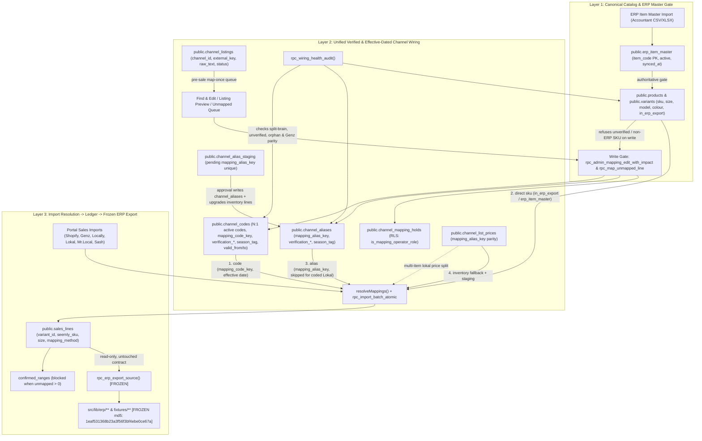

# Unified SKU Mapping Goal Architecture

This document defines the **single target architecture** for SeemlyOps SKU mapping (`~/Code/seemlyops`), reconciling:
1. Baseline audit findings (`[[phase-1-baseline]]`: `[[SKU-AUD-001]]`..`[[SKU-AUD-009]]`) and Phase A–D remediation (`[[SKU-TCK-001]]`..`[[SKU-TCK-007]]`).
2. Changes already shipped in `sku-mapping-rebuild` (`19345270` live, `734f2fd7` on `main`, migration `20261125100000_mapping_rebuild_ops.sql`).
3. Post-deploy `sku-review` data cleanups, ledger confirmations, and open owner decisions (`Work/sku-review/*`, `Plans/decisions.md`).
4. Target-state capabilities for Phases E–F (`[[SKU-TCK-008]]`..`[[SKU-TCK-010]]`): `erp_item_master` gate, mapping provenance & effective-dated seasonal remaps, split-brain closure, `rpc_wiring_health_audit()`, and map-once `channel_listings`.

> **Governing Canons**: [[01-ousterhout-module-depth]], [[02-kleppmann-schema-evolution]], [[03-kimball-star-schema-retail]], [[04-ddd-bounded-contexts]], [[09-clean-architecture-boundaries]], [[11-nygard-production-stability]], [[13-postgres-query-performance]], [[14-owasp-security-and-supabase-rls]].

---

## 1. Current State Reconciliation (What Already Shipped vs Open Gaps)

### 1.1 Already Shipped in `sku-mapping-rebuild` (`19345270` / `734f2fd7`)
- **Ops Migration (`supabase/migrations/20261125100000_mapping_rebuild_ops.sql`)**: Function-body-only migration (with `-- REVERSE:` restoring `6db66a7b`). Extended `rpc_admin_batch_mapping_edit`, `rpc_mapping_edit_impact`, and `rpc_admin_mapping_edit_with_impact` (adds `LOCK TABLE channel_aliases`) with `alias_move`, `alias_clear`, `code_clear`, `product_edit`, and `new_sku` (supporting `model`, `colour`, showroom code arrays, and aliases). `alias_move`/`alias_clear` update name-mapped lines (`mapping_method IN ('alias','manual')` not covered by an active code; code/sku/inventory lines untouched). `rpc_sku_mapping_facets` includes `named` counts and alias-only showrooms (Sash).
- **Backend & API**:
  - `GET /api/sku-mapping/lookup` (`lookup.ts`, `lookup-repo.ts`): style-grouped search (`ilike` across SKU/style/name/model/code/alias, max 20 styles).
  - `POST /api/sku-mapping/listing-preview` (`listing-plan.ts`, `listing-plan-repo.ts`): read-only style-level listing preview (`genz_prefix` `1..5 -> XS..XL`, text portals by name+colour+size token; flags `new`/`same`/`move`/`missing_size`/`no_size`).
  - `genz-guard.ts` + `suggest.ts`: permits `ONE`-only styles with a warning (Decision 104.5) and surfaces `missing_size` hints in the queue.
  - `resolve-mappings.ts` (T04): Lokal lines with a non-empty `channelCode` stay code-only (skip alias/inventory fallback when code is unknown); legacy code-less lines keep the name route.
- **Frontend**:
  - `/sku-mapping` (`_components/find-edit/*`, `?tab=edit` preserved): **Find & edit** workflow with family -> colour -> size cards, N:1 active codes (`size-row.tsx`), aliases (Sash visible), shared `MappingPreviewPanel`, Add size/colour/style, Edit style, and Map a listing panel.
  - Confirm days (`/imports`, `readiness-model.ts`, `confirmations-repo.ts`): `unmapped` state takes precedence over `confirmed`/`imported` and disables Confirm when `unmapped > 0`.

### 1.2 Applied & Open in `sku-review` (Live Data State)
- **Applied via live `19345270`**: MF-1 Lokal `2069-S/L -> 2068-S/L` alias move; 92 rows from `pending_decisions.csv` + Genz `1118-4-2 -> 99`; `pending_remaps.csv` mint XS (`131-XS -> 1007-XS`). Dry re-resolution SQL across 1 Oct–23 Nov (Genz/Locally/Lokal/mr.local) produced **0 differences**.
- **Ledger status**: `lokal`, `locally`, `mr.local` **54/54 days match & confirmed** (Decision 105: `lokal` 1–7 Nov re-confirmed with ERP correction `v3`).
- **Pre-Wave Owner Stops & Follow-Ups**:
  - **Sash hard stop** (Decision 95 / 102): Zero Sash mapping or ledger changes until Jooubie confirms the Sash wiring list.
  - **Genz catch-up**: 22–23 Nov not imported and 15–21 Nov net unverified (Genz Brand Sales export HTTP 500 on 24 Nov).
  - **`conflict-review.md` open owner questions**: Genz colour `36` (6 dark/charcoal styles), Shopify `5001/5002` vs `5015/5016` (Decision 63, queued in `[[SKU-TCK-008]]`), Genz `70034`/`11062` remaps, `2042-xs` lowercase ERP key, Shopify legacy/`3001-Black-XL`.
  - **`family-colour-proposal.md`**: 329 products -> 87 proposed families (`products.model`, `products.colour`), unapplied pending owner review.
  - **Housekeeping**: `sales_lines.size` NULL backfill (Decision 16), 244 `channel_alias_staging_source_batch_id_fkey` orphans, `Seemly-Wiki/wiki/database/sku-and-catalogue-tables.md:29` stale claim about `in_erp_export`.

### 1.3 Confirmed Architectural Gaps (Current vs Target)
1. **No authoritative `erp_item_master` gate in Postgres**: `variants.in_erp_export` (`DEFAULT true` at `supabase/schema.sql:12857`) is only checked in TS (`mapping-repo.ts:73,82`, `csv-import-plan.ts:63`) and is ignored by Postgres write RPCs and by `rpc_erp_export_source` (`supabase/schema.sql:5101-5170`).
2. **No provenance or effective dating on wiring**: `channel_codes` (`schema.sql:11181-11190`) and `channel_aliases` (`schema.sql:11168-11174`) have no `verification_status`, `verified_by`, `verified_at`, `source`, `season_tag`, `valid_from`, or `valid_to`. Remapping rewrites all historical `sales_lines` (`schema.sql:2769-2785`, `20261125100000:538-549`).
3. **Split-brain & key drift across 4 tables**: `channel_codes` (`mapping_code_key`), `channel_aliases` (`mapping_alias_key`), `channel_list_prices` (exact `(channel_id, product_text)` at `schema.sql:13143`), and `channel_alias_staging` (exact `(channel_id, product_text)` at `schema.sql:13738`). Staged-alias approval (`rpc_resolve_staged_alias`, `schema.sql:7467-7492`) leaves `mapping_method = 'inventory'` lines untouched; `alias_move` leaves `inventory` lines untouched; `rpc_map_unmapped_line` (`schema.sql:5403-5570`) crashes `23505` on normalized twins and omits `size`.
4. **No `rpc_wiring_health_audit()` & TS-only Genz guards**: `rpc_wiring_health_audit()` does not exist; `genzCodeGuard` lives only in TS (`genz-guard.ts`, `genz-guard-repo.ts:56` using exact `.eq('channel_code', code)`) and skips `new_sku.codes`.
5. **No pre-sale `channel_listings` registry**: `sku-mapping-rebuild` added read-only `listing-preview`, but there is no `channel_listings` table fed by portal stock/catalogue exports or Genz unsold rows (`[[SKU-TCK-010]]`).

---

## 2. Three-Layer Target Architecture

### Layer 1: Canonical Catalog & `erp_item_master` Gate (`[[03-kimball-star-schema-retail]]`, `[[SKU-TCK-008]]`)
- **Authoritative Source**: `public.erp_item_master` holds the accountant-exported ERP Item List (`item_code` normalized/PK, `item_name`, `product_group`, `active`, `synced_at`).
- **Write-Side Enforcement**:
  - Mapping writes (`rpc_admin_mapping_edit_with_impact`, `rpc_map_unmapped_line`, CSV mapping import) and `new_sku` creation check `erp_item_master` (when populated) before activating or wiring a SKU, preventing ghost SKUs (`5001/5002` style mismatches) from ever entering `sales_lines`.
  - `variants.in_erp_export` is synced from `erp_item_master` rather than left as an unverified `DEFAULT true`.
- **Pre-Export Readiness**: A pre-export diagnostic check flags any confirmed/unexported `sales_lines.seemly_sku` missing from `erp_item_master` **without altering `rpc_erp_export_source` or `src/lib/erp/**`**.

### Layer 2: Unified Verified & Effective-Dated Channel Wiring (`[[04-ddd-bounded-contexts]]`, `[[SKU-TCK-001]]`..`[[007]]`, `[[009]]`, `[[010]]`)
- **Single Authenticated Write Entrypoint (`[[SKU-TCK-002]]`)**: Revoke direct `authenticated` `EXECUTE` on `rpc_admin_batch_mapping_edit` and `rpc_admin_edit_channel_mapping`; all session writes flow through `rpc_admin_mapping_edit_with_impact` (`p_expected_impact` + deterministic lock order).
- **RLS Alignment (`[[SKU-TCK-001]]`)**: `channel_mapping_holds`, `channel_alias_staging`, `automap_batches`, `automap_actions` use `is_mapping_operator_role()` (`admin`, `manager`, `finance`), matching `channel_codes` and `channel_aliases`.
- **Provenance & Verification (`[[SKU-TCK-009]]`)**: `channel_codes` and `channel_aliases` gain additive provenance columns (`verification_status` `'unverified'|'verified'|'disputed'`, `verified_by`, `verified_at`, `source`, `season_tag`).
- **N:1 Codes & Effective-Dated Remaps (`[[SKU-TCK-009]]`)**:
  - **Preserve N:1 active codes** on `channel_codes` (unique on `(channel_id, mapping_code_key(code)) WHERE active`, NOT on `(channel_id, variant_id)`), because Rizz dual barcodes and Genz `3008`/`3347` legitimately share a variant. Add an explicit UI/preview confirmation step when adding an additional active code to a variant that already has one.
  - **Effective dating (`valid_from` / `valid_to`) + forward-only remaps**: New `remap_mode` (`'forward_only'` default when confirmed/exported periods exist vs explicit `'rewrite_all'`) prevents silent rewrites of closed/exported months (protecting Aug–Sep and Decision 104.2/105).
- **Unified Normalization & Split-Brain Closure (`[[SKU-TCK-003]]`, `[[SKU-TCK-004]]`, `[[SKU-TCK-005]]`, `[[SKU-TCK-007]]`, `[[SKU-TCK-009]]`)**:
  - One canonical key contract everywhere (`public.mapping_code_key(text)` and `public.mapping_alias_key(text)` with `COLLATE "C"`): applied to `sales_lines` partial functional indexes, `channel_alias_staging` pending uniqueness, `channel_list_prices` normalized lookup/uniqueness, `rpc_unresolved_sales`, `rpc_map_unmapped_line`, `rpc_automap_*`, and `genz-guard-repo.ts`.
  - Approving a staged alias (`rpc_resolve_staged_alias`) upgrades matching `mapping_method = 'inventory'` rows to `'alias'`/`'manual'` cleanly; `alias_move` handles `'inventory'` rows consistently when no active code covers them.
- **Health & DB Guardrails (`[[SKU-TCK-006]]`, `[[SKU-TCK-009]]`)**:
  - Postgres `rpc_wiring_health_audit()` reports split-brain mismatches, unverified active mappings, `erp_item_master` drift, staged/list-price orphans, and Genz suffix mismatches (preserving the `ONE`-size warning-not-refusal rule per Decision 104.5).
- **Pre-Sale Map-Once Registry (`[[SKU-TCK-010]]`)**:
  - `public.channel_listings` records active portal listings from stock/catalogue exports and Genz `0/0` unsold rows, surfacing a "New listings to map" queue backed by `listing-preview` before the first sale arrives.

### Layer 3: Automatic Import Resolution -> `sales_lines` -> Frozen ERP Export
- **Import Resolution (`resolveMappings` + `rpc_import_batch_atomic`)**: Resolves incoming lines deterministically in tier order (`code` via `mapping_code_key` & active/effective window -> `sku` gated by `erp_item_master`/`in_erp_export` -> `alias` via `mapping_alias_key`, skipped for coded Lokal lines -> `inventory` via `channel_list_prices` + staging).
- **Confirm-Day Gate**: Confirming a day remains blocked whenever `unmapped > 0` (`readiness-model.ts`).
- **Frozen ERP Boundary**: `sales_lines` feeds `rpc_erp_export_source` (`schema.sql:5101-5170`), `src/lib/erp/**`, and `fixtures/**` unchanged.

---

## 3. Non-Negotiable Frozen & Safety Invariants

1. **Frozen ERP Export**: `src/lib/erp/**`, `fixtures/**`, `scripts/verify-erp-*`, and `rpc_erp_export_source` (`supabase/schema.sql:5101-5170`) + the 6 frozen ERP SQL functions MUST NOT be modified. `node scripts/verify-erp-fixtures.mjs | md5sum` MUST equal `1eaf531368b23a3f56f3bf4ebe0ce67a`.
2. **Ingestion Core**: Any change touching `src/lib/imports/**` or `src/lib/shopify/**` (or `resolve-mappings.ts`) requires regression tests proving existing behavior is unchanged.
3. **Additive Migrations Only (`[[02-kleppmann-schema-evolution]]`)**: Never edit an applied migration; every new SQL migration includes `SET LOCAL lock_timeout` and a valid `-- REVERSE:` block verified by `verify-migration-reverse.mjs`. No `CONCURRENTLY` inside transactional migrations.
4. **Preserve `sku-mapping-rebuild` Contracts**:
   - Keep N:1 active `channel_codes` per `(channel_id, variant_id)` (do NOT add a unique constraint on `(channel_id, variant_id)`).
   - Keep the Genz `ONE`-size warning-not-refusal rule (`genz-guard.ts:57-58`, Decision 104.5).
   - Keep coded Lokal lines code-only (never fall back to alias/inventory when `channel_code` is non-empty).
5. **Operator & Historical Gates**:
   - **Sash hard stop**: Zero Sash mapping or ledger writes without Jou's explicit Sash sign-off.
   - **Historical protection**: Never silently alter Aug–Sep or confirmed/exported ranges (including `100-*` vintage jeans per Decision 104.2).
   - **No manual prod writes / no invented SKUs or totals**: All data fixes flow through audited app endpoints/RPCs or approved migrations; production deploys and DB pushes require Jou's explicit `deploy`/go in the active session.
