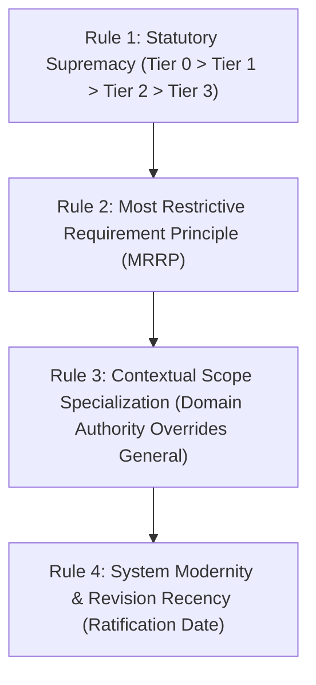

# Engineering Audit Knowledge Graph & Canon Index

Welcome to the **Engineering Audit Knowledge Graph**. This repository serves as the authoritative technical foundation, code quality canon, and decision-making reference for all human engineers and autonomous coding agents.

The principles and standards codified here are synthesized from seminal software engineering literature ("proof books"), international standards bodies, statutory compliance frameworks, and high-throughput production architectures.

---

## 1. Master Conflict Resolution & Precedence (Reference 00)
When standards, frameworks, or guidelines conflict during an audit or code review, the following four master rules govern resolution automatically:

See the full specification and conflict matrix in [00-canon-index-and-conflicts.md](./00-canon-index-and-conflicts.md).

---

## 2. The 15 Canonical Engineering Authorities & Proof Books

| Ref ID | Title / Domain | Primary Proof / Author | Core Principle Enforced |
|---|---|---|---|
| **[Ref 01](./01-ousterhout-module-depth.md)** | Module Depth & Complexity | *A Philosophy of Software Design* (John Ousterhout) | Deep modules (simple interface, powerful implementation). Eliminate classitis and shallow abstractions. |
| **[Ref 02](./02-kleppmann-schema-evolution.md)** | Schema Evolution & Storage | *Designing Data-Intensive Applications* (Martin Kleppmann) | Additive migrations, backward/forward compatibility, dual-write phases, and immutable event streams. |
| **[Ref 03](./03-kimball-star-schema-retail.md)** | Dimensional Data Modeling | *The Data Warehouse Toolkit* (Ralph Kimball) | Fact and dimension separation, conformed dimensions, surrogate keys, and retail analytics star schemas. |
| **[Ref 04](./04-ddd-bounded-contexts.md)** | Domain-Driven Design | *Domain-Driven Design* (Eric Evans / Vaughn Vernon) | Strict bounded contexts, aggregate root invariants, ubiquitous language, and explicit anti-corruption layers (ACL). |
| **[Ref 05](./05-khorikov-testing-policy.md)** | Deterministic Unit Testing | *Unit Testing Principles, Practices, and Patterns* (Vladimir Khorikov) | Test business logic through observable behavior. Reject testing implementation details; enforce deterministic test suites. |
| **[Ref 06](./06-fowler-refactoring-vocabulary.md)** | Refactoring Vocabulary | *Refactoring: Improving the Design of Existing Code* (Martin Fowler) | Named, atomic refactorings (Extract Function, Replace Conditional with Polymorphism). Never mix refactoring with feature edits. |
| **[Ref 07](./07-typescript-conventions.md)** | TypeScript Type Safety | Modern TypeScript Strict Standards | Strict mode, discriminated unions, `unknown` over `any`, Zod boundary parsing, and branding types for identifiers. |
| **[Ref 08](./08-pragmatic-principles.md)** | Pragmatic Engineering | *The Pragmatic Programmer* (Andrew Hunt & David Thomas) | DRY, orthogonality, design by contract, broken windows theory, tracer bullets, and irreversible choice avoidance. |
| **[Ref 09](./09-clean-architecture-boundaries.md)** | Clean Architecture | *Clean Architecture* (Robert C. Martin) | The Dependency Rule: inner domain layers have zero dependencies on frameworks, databases, or UI. Explicit boundary ports. |
| **[Ref 10](./10-evolutionary-fitness-functions.md)** | Evolutionary Fitness Functions | *Building Evolutionary Architectures* (Neal Ford et al.) | Automated architecture linters, dependency cycle tests, bundle budgets, and contract fitness tests. |
| **[Ref 11](./11-nygard-production-stability.md)** | Production Stability & Resilience | *Release It!* (Michael T. Nygard) | Circuit breakers, timeouts, bulkheads, steady state, fail-fast mechanics, and cascading failure prevention. |
| **[Ref 12](./12-data-engineering-lifecycle.md)** | Data Engineering Lifecycle | *Fundamentals of Data Engineering* (Joe Reis & Matt Housley) | Generation, storage, ingestion, transformation, serving. Idempotent pipeline transformations and metadata auditing. |
| **[Ref 13](./13-postgres-query-performance.md)** | Postgres Query Performance | *Use The Index, Luke* (Markus Winand) | B-Tree indexing, N+1 query elimination, composite index column order, heap fetch elimination, and `EXPLAIN (ANALYZE, BUFFERS)`. |
| **[Ref 14](./14-owasp-security-and-supabase-rls.md)** | Application Security & RLS | *OWASP Top 10* & Supabase Postgres Security | Row-Level Security on every tenant table, parameterized queries, `SECURITY DEFINER` search-path protection, and tenant isolation. |
| **[Ref 15](./15-ui-craft-and-wcag22.md)** | UI Craft & Accessibility | WCAG 2.2 AA / APG Standards | Semantic HTML, accessible keyboard navigation, color contrast ratios, focus visible rings, and mobile viewport responsive craft. |

---

## 3. Architecture Blueprint & System Topology

The target platform architecture modeled in this audit environment represents a modern high-scale multi-tenant retail analytics & ERP engine:

- **[target-codebase-blueprint.md](./target-codebase-blueprint.md)**: Full monorepo topography, database schema-per-tenant, immutable financial ledger invariants, and background job synchronization boundaries.

---

## 4. Operational Specifications & Tooling Guides

The knowledge graph includes complete operational guides for static and runtime inspection tools:

1. **Preflight Suite**: [preflight-suite-specification.md](./preflight-suite-specification.md)
   - Runnable script: [scripts/preflight.sh](../scripts/preflight.sh)
2. **Postgres Live Catalog Audit**: [postgres-catalog-audit.md](./postgres-catalog-audit.md)
   - Runnable SQL: [scripts/audit-supabase-catalog.sql](../scripts/audit-supabase-catalog.sql)
3. **ESLint 9 Boundaries Specification**: [eslint-boundaries-specification.md](./eslint-boundaries-specification.md)
   - Config file: [configs/eslint.config.mjs](../configs/eslint.config.mjs)
4. **Knip Dead Code Analysis**: [knip-configuration-guide.md](./knip-configuration-guide.md)
   - Config file: [configs/knip.json](../configs/knip.json)
5. **Squawk Migration Linter**: [squawk-configuration-guide.md](./squawk-configuration-guide.md)
   - Config file: [configs/squawk.toml](../configs/squawk.toml)
6. **Audit Reporting**: [audit-report-template.md](./audit-report-template.md)
   - Template file: [templates/audit-report-template.md](../templates/audit-report-template.md)

---

## 5. Agent Instructions & Operational Grounding

Coding agents must load and consult relevant chapters of this wiki before proposing or executing fixes:
- When modifying database tables, consult [Ref 02 (Schema Evolution)](./02-kleppmann-schema-evolution.md) and [Ref 13 (Postgres Query Performance)](./13-postgres-query-performance.md).
- When altering domain logic, consult [Ref 04 (DDD Bounded Contexts)](./04-ddd-bounded-contexts.md) and [Ref 09 (Clean Architecture)](./09-clean-architecture-boundaries.md).
- When writing tests, consult [Ref 05 (Testing Policy)](./05-khorikov-testing-policy.md).
- When auditing security or multi-tenant queries, consult [Ref 14 (OWASP & Supabase RLS)](./14-owasp-security-and-supabase-rls.md).
- When handling financial ledger entries, ensure immutability and fixed decimal math per [target-codebase-blueprint.md](./target-codebase-blueprint.md).
